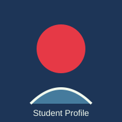

# Assignment-05: Links and Images

- **Name:** Anant Pratap Singh
- **Student ID:** BCS2025542
- **Course:** B.Tech CSE - Second Year
- **Subject:** HTML and CSS Introduction Lab (BCS352)
- **Institution:** Invertis University, Bareilly

---

## 🎯 Aim
Link two pages together and add a picture with alt text.

---

## 📝 Tasks & Solutions

### Task 1: home.html
**Problem Statement:**
> Create home.html with the heading Welcome to My Site and a paragraph with a link to portfolio.html. The link text is portfolio.

**Source Code:**
```html
<!--
  Name: Anant Pratap Singh
  Student ID: BCS2025542
  Institution: Invertis University, Bareilly
  Course: B.Tech CSE - Second Year
  Subject: HTML and CSS Introduction Lab (BCS352)
  Assignment: 5 - Links and Images
  Task: 1
-->
<!DOCTYPE html>
<html lang="en">
<head>
  <meta charset="UTF-8">
  <title>Home Page</title>
</head>
<body>
  <h1>Welcome to My Site</h1>
  <p>Explore my projects and achievements by visiting my <a href="portfolio.html">portfolio</a>.</p>
</body>
</html>
```

**Output / Result:**
```text
Clicking the link "portfolio" navigates to portfolio.html.
```

---
### Task 2: portfolio.html
**Problem Statement:**
> Create portfolio.html with a heading and a link back to home.html. Write any text for the link.

**Source Code:**
```html
<!--
  Name: Anant Pratap Singh
  Student ID: BCS2025542
  Institution: Invertis University, Bareilly
  Course: B.Tech CSE - Second Year
  Subject: HTML and CSS Introduction Lab (BCS352)
  Assignment: 5 - Links and Images
  Task: 2
-->
<!DOCTYPE html>
<html lang="en">
<head>
  <meta charset="UTF-8">
  <title>Portfolio Page</title>
</head>
<body>
  <h1>My Portfolio</h1>
  <p>Welcome to my student portfolio. Return to the <a href="home.html">Back to Home</a>.</p>
</body>
</html>
```

**Output / Result:**
```text
Clicking "Back to Home" navigates back to home.html.
```

---
### Task 3: portfolio-image.html
**Problem Statement:**
> Create portfolio-image.html with a heading and a picture from the images folder. Set its width and height to 200 each, and write alt text that describes it.

**Source Code:**
```html
<!--
  Name: Anant Pratap Singh
  Student ID: BCS2025542
  Institution: Invertis University, Bareilly
  Course: B.Tech CSE - Second Year
  Subject: HTML and CSS Introduction Lab (BCS352)
  Assignment: 5 - Links and Images
  Task: 3
-->
<!DOCTYPE html>
<html lang="en">
<head>
  <meta charset="UTF-8">
  <title>Portfolio Image</title>
</head>
<body>
  <h1>Student Profile Photo</h1>
  
</body>
</html>
```

**Output / Result:**
```text
Displays a 200x200 image with descriptive alt text for accessibility.
```

---

